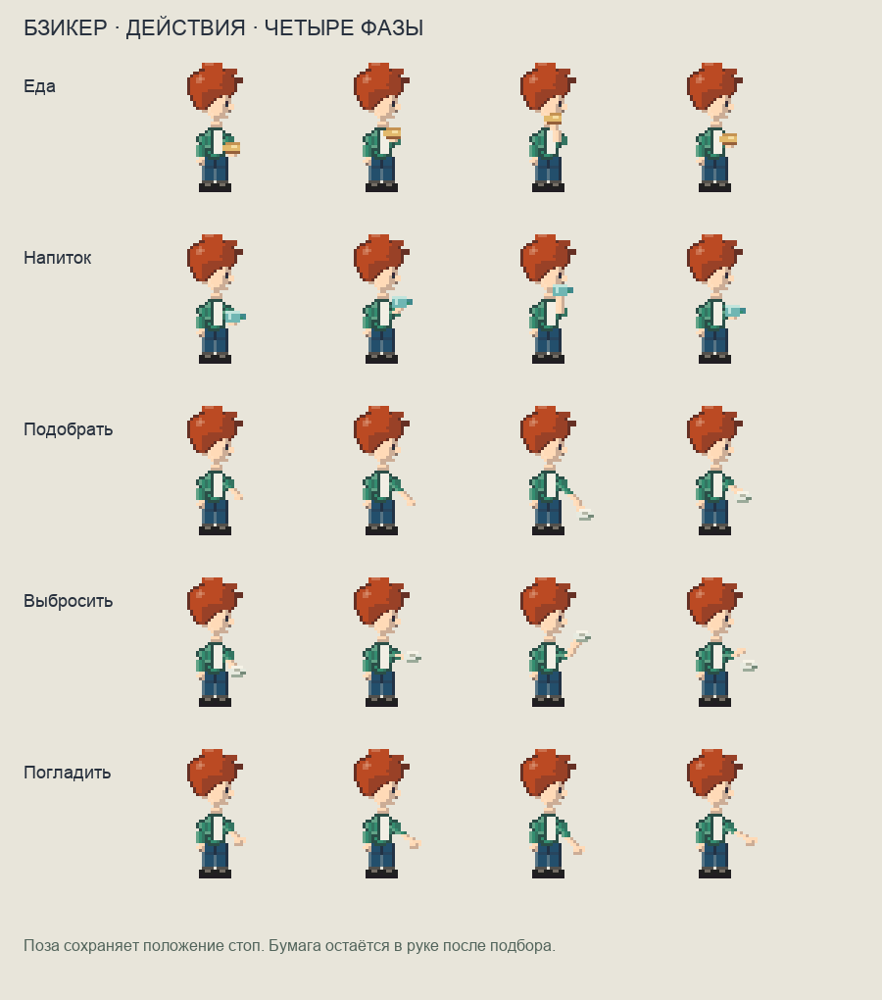

# Бзикер — жесты действий v7

Добавлены настоящие пиксельные жесты еды, напитка, подбора мусора, броска в урну и поглаживания животного. Каждый жест состоит из четырёх различных кадров общего персонажа; положение на карте и точка опоры остаются прежними.



## Контракт отрисовки

В `drawAvatarCanvas` и третьем аргументе `avatarSVG`:

```js
{
  pose: 'idle',           // либо 'sit'; базовая поза и ноги сохраняются
  facing: 'right',        // down / up / left / right
  action: 'eat',          // eat / drink / pick-litter / throw-litter / pet
  actionFrame: 0,         // 0–3; серверное время определяет общий кадр
  phoneOpen: false,
  holding: 'litter'       // после успешного подбора; убрать после сдачи мусора
}
```

Одноимённый `pose: 'eat'` и `poseFrame` поддерживаются как сокращённый вызов, когда персонаж стоит. Для сохранения сидения следует использовать отдельное `action`. Отрицательный или нечисловой кадр выбирает начало; кадр выше трёх выбирает заключительную фазу. Во время жеста обычная анимация ходьбы не запускается.

Еда и чашка поднимаются к рту без изменения глаз и причёски. При подборе рука опускается и затем поднимает бумагу. Бросок состоит из замаха, движения руки и отделения бумаги. При поглаживании открытая ладонь двигается вниз к животному. После окончания подбора `holding: 'litter'` рисует бумагу у кисти во время обычного стояния и всех восьми фаз ходьбы; она видна также при сидении и телефоне. При активном жесте руки этого действия получают приоритет перед руками телефона, а ориентация головы телефона и сидящие ноги сохраняются. Нейтральный персонаж жюри и каталог только головы игнорируют личные действия и предмет в руке.

## Проверка

Команда: `node --test tests/avatar-*.test.mjs` — **27 проверок прошли**. Новые проверки выявили отсутствующие кадры, предмет в руке и сокращённые вызовы до реализации. После исправлений проверены четыре различных кадра в каждом направлении, неподвижные глаза/волосы и стопы, сохранение сидящих ног, камера при телефоне, зеркальность левого/правого жеста и прикреплённые кисти. Перебраны **560 комбинаций**: 7 костюмов × 4 направления × 5 действий × 4 фазы; пиксели остаются внутри 32×48. Предмет в руке дополнительно проверен во всех 32 комбинациях направления и фазы ходьбы.

Этот слой отвечает за рисунок. Серверные последствия покупки/использования еды, получения и сдачи мусора, синхронизация времени и запуск жеста в городе интегрируются общим этапом. В этом изменении рабочие аккаунты и инвентарь не менялись.
