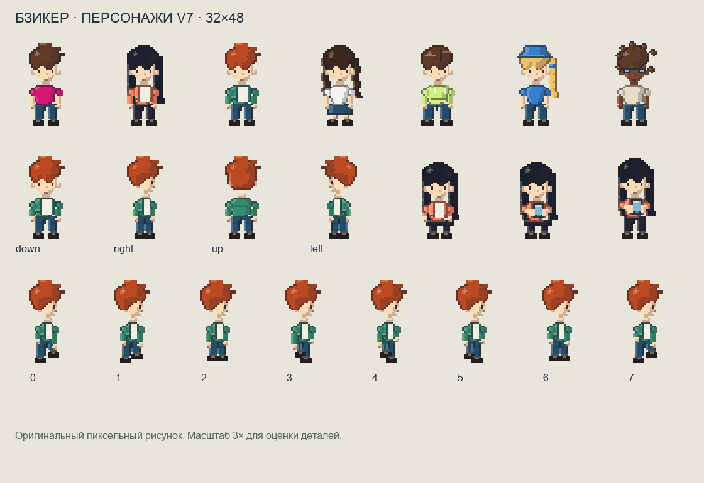

# Бзикер — персонажи v7

Персонаж перерисован по направлению, заданному приложенными Владиславом примерами: неровный контур причёски, компактное лицо, читаемые плечи, руки, ноги и материальные тени. Это оригинальная пиксельная отрисовка; совпадение с коммерческим референсом до каждого пикселя не заявляется. Лошади из последнего изображения не входят в эту задачу.

## Общая геометрия

Внутренний кадр увеличен с 24×36 до 32×48. Опорная точка — (16, 47), восемь фаз ходьбы. В городе масштаб 1,5 даёт кадр 48×72; геометрия соседей и игрока совпадает. Положение на реальной скамейке, на лодке и на облаке сохраняется. Округление обоих краёв каждого пикселя устраняет щели между строками при дробном масштабе.

Canvas, SVG, каталог, карточные комнаты и облака используют один набор непрозрачных пикселей. Новый третий аргумент `avatarSVG(input, false, options)` позволяет карточному залу показывать сидящих персонажей; существующие двухаргументные вызовы совместимы. У каждого материала есть основной тон, блик, свет, тень и тёмный край. Готовые строки пикселей объединяются в горизонтальные полосы; кэш ограничен 512 кадрами.

## Сохранение внешности и поз

Все прежние значения пола, оттенков кожи и вещей, 12 причёсок, одежды, аксессуаров, головных уборов и 7 костюмов сохраняют свои индексы. У причёсок меняется рисунок, а сохранённый выбор остаётся. Обувь, складки, воротники, карманы и аксессуары читаются в новом кадре. Спрайт жюри использует нейтральную внешность и не зависит от личных частей, направления и позы.

В восьми фазах голова не смещается и не меняет лицо. Плечи остаются прикреплены к корпусу; контакт стоп и нижняя часть рук чередуются. Боковые направления зеркальны. При открытом телефоне голова обращается к камере, кисти держат экран у верхней части корпуса; сидение сохраняет ноги и опору. Стопы сидящего сближены для более естественной позы. Прежний жест поглаживания, который накладывается в городском рендере, совместим с новой геометрией.

## Проверка

Команда из каталога приложения: `node --test tests/avatar-*.test.mjs tests/world-lifecycle.test.mjs`.

Результат: **82 проверки прошли** — 23 проверки аватара и 59 проверок взаимодействия с городом. Новые проверки сначала выявили отсутствующую геометрию 32×48, некомпозируемую SVG-позу и дробные края пикселей. После изменений они проходят. Дополнительно проверены неизменность всех допустимых сохранённых индексов, четыре направления и восемь различных кадров, стабильность головы, сохранение сидящих ног при телефоне, нейтральное жюри, зеркальность и связность плеч/манжет/рук в 64 комбинациях пола, направления и фазы.

Ожидания существующих проверок перенесены на согласованный кадр 32×48. Проверки объёма материалов, формы подбородка/талии, головных уборов без лица и интерполяции соседей сохранены. В проверке удалённого игрока изменена только новая опорная точка и масштаб; условия плавного движения и остановки у серверной позиции оставлены.

Контактный лист отрисован из настоящих кадров `web/avatar.js`, с целым масштабом 3×. Рабочую базу данных, покупки и профиль при этой работе не изменяли. Браузерную проверку в игровой сцене выполняет общий интеграционный этап.
