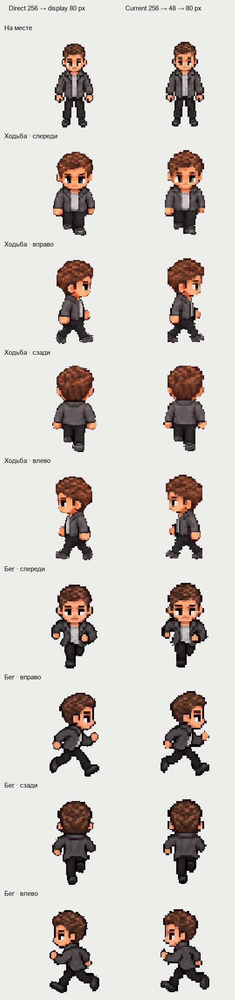

# Source character proportions and sampling

Investigation on 2026-10-11. No source character artwork was edited.

## Verified import behavior

`scripts/import-source-actors.py:42` uses one uniform scale for both axes:
male `.32`, female `.305`. A square 256×256 source frame therefore becomes
82×82 / 78×78 before being placed in a transparent 48×64 cell. The common
feet anchor is `[24,63]`. Each four-frame group shares one scale.

All 72 male/female base idle, walking and running cells were reconstructed
from their 256×256 source frames in memory and matched the saved PNG cells
byte for byte. The visible frame bounds fit inside their runtime cells.
No face was cropped and no source colors were replaced by the importer.
`material_layout` only computes metadata.

## Proportion measurements

Source folder: `source-reference/02_Персонажи/Мужчина`.
Original-image body bounds use opacity greater than 245. Warm hair pixels
are a reproducible color proxy: `r < 170`, `r > 1.15*g`, `g > 1.06*b`.
They are measured in the upper 44% of the original pose, or the upper
72 source pixels of an already normalized 256×256 action frame.

| Image / first action frame | Visible body height | Warm hair width | Width / height |
| --- | ---: | ---: | ---: |
| `01_Основной.png` | 1268 | 394 | .3107 |
| Current 256×256 idle | 180 | 56 | .3111 |
| `02_Ракурсы_4.png`, front | 755 | 243 | .3219 |
| Same sheet, left | 756 | 241 | .3188 |
| Same sheet, back | 753 | 247 | .3280 |
| Same sheet, right | 755 | 229 | .3033 |
| Current walking, front | 180 | 78 | .4333 |
| Current running, front | 180 | 81 | .4500 |

The importer does not explain the narrow idle head. The main original and
imported idle have almost identical proportions. The supplied walking and
running drawings already have relatively wider heads. The four-view
reference front is about 3.6% wider relative to height than the imported
idle; front running is about 44.6% wider.

The source action catalog uses `01_Основной.png` for idle,
`Анимации/00_Исходники/Лист_циклов.png` for walking, and the original
`03_Бег_4_направления.png` for running. At investigation time, runtime
side/back idle used a walking frame instead of a supplied four-view pose.

## Detail comparison

Left: one nearest-neighbor pass from the 256×256 source to an 80×107
display cell. Right: current 256→48×64→80×107 path. The comparison itself
is enlarged 2× for inspection. It shows loss of small eye, hair and shoe
details after the intermediate 48×64 reduction.

An in-memory 96×128 intermediate, with doubled anchor `[48,126]`,
preserved more source detail at this display size. Relative to the direct
render, absolute RGBA error over the union of opaque character pixels was
20.76→11.27 for first front-walking frame and 20.82→10.87 for first
front-running frame. This comparison measures sampling, not anatomical
accuracy, and does not justify changing the supplied body proportions.
