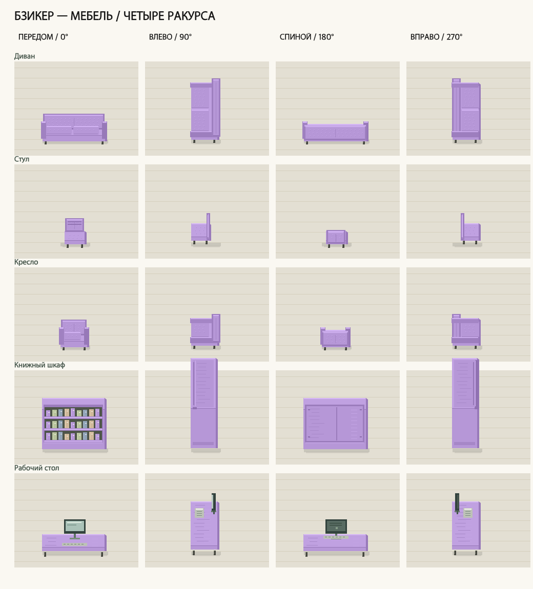
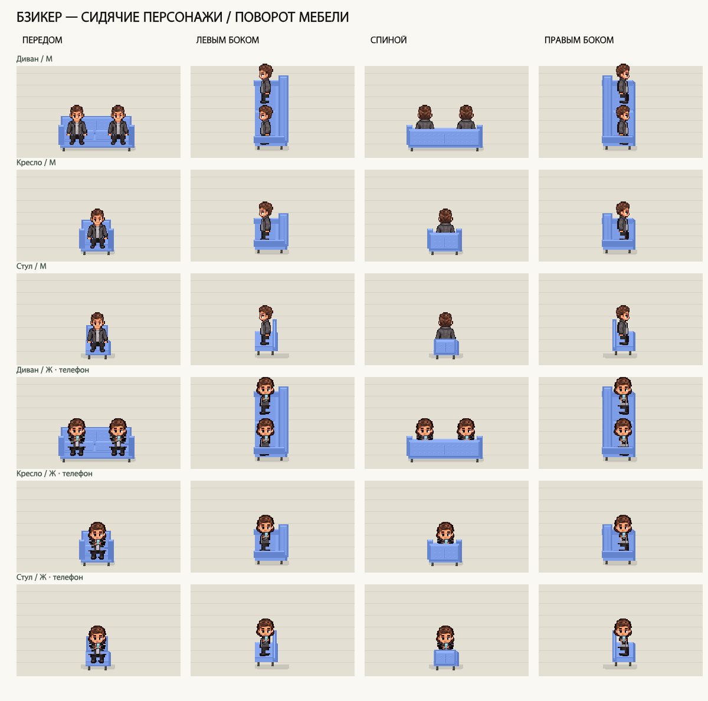

# Бзикер v16 — поворот мебели в четырёх направлениях

В редакторе клановой базы все 15 видов мебели можно поставить передом, левым боком, спиной или правым боком. Направление сохраняется вместе с предметом. Экран, спинка и вертикальные части остаются вертикальными; для бокового и заднего положения используются отдельные рисунки.

## Управление

Лидер клана входит на базу, открывает «Обстановку» и касается клетки существующего предмета. «Ракурс» выбирает конкретное направление, «↻ Повернуть» переключает следующий поворот. На компьютере действует R, в том числе при русской раскладке. Вне открытого редактора R мебель не меняет.

Кнопка поворота имеет высоту не меньше 44 CSS-пикселей. Рядом показаны предпросмотр и размер занимаемой области. Невозможный поворот сохраняет прежнее положение и сообщает, что нужно свободное место. После изменений нужно нажать «Сохранить».

## Размещение и посадка

Повороты 90° и 270° меняют местами количество занимаемых рядов и столбцов. Клиент и сервер проверяют весь размер, границы комнаты и пересечения с другими твёрдыми предметами. Ковёр по-прежнему можно положить под мебель.

Места посадки поворачиваются вместе с предметом; сохраняются их идентификаторы. Направление сидящего персонажа соответствует сиденью. У дивана, кресла и стула тело мебели, сидящий персонаж и ближняя спинка/подлокотники рисуются отдельными слоями. Небольшое визуальное смещение сидячего рисунка согласует его с подушкой, сохраняя серверную позицию и открытый телефон.

Если сохранённый поворот меняет занятое сиденье, сервер освобождает посадку и сохраняет телефон открытым. Гости не получают право редактирования. Старые предметы без поля `rotation` сохраняют прежний размер и основной рисунок; несовместимая новая передняя накладка к ним не применяется.

## Проверка

- JavaScript: **420/420**; полный свежий журнал — [furniture-rotation-v16-js.log](furniture-rotation-v16-js.log).
- Python: **244/244**; полный свежий журнал — [furniture-rotation-v16-python.log](furniture-rotation-v16-python.log).
- Проверены четыре поворота, смена занимаемой области, отказ при пересечении/выходе за край, сохранение после повторного создания сервиса, неправильные типы/углы, права гостя и старые предметы.
- Проверены касание выбранного предмета, кнопка поворота, R, ручной выбор ракурса и отправка сохранения через обработчики редактора.
- Растровая проверка головы: 64 головы в 48 сочетаниях предмета, пола, направления и телефона. Дополнительно просмотрены изображения с фактическими функциями `drawAvatar`, `baseActorPlacement` и сортировкой слоёв.
- Независимая повторная проверка: 82 теста; открытых подтверждённых замечаний в этой области нет.
- После перезапуска основной сервер отвечает на прежнем адресе `http://127.0.0.1:8791/`; проверена загрузка 33 связанных модулей и каталога с четырьмя направлениями. Новый модуль доступен и от корня страницы, и по `/web/`.
- Контрольные суммы шести проверенных таблиц основного прогресса после перезапуска совпадают. Проверка целостности SQLite — `ok`.

Ограничение проверки: существующие вкладки встроенного браузера в этой сессии не подключались к управлению. Новые вкладки не создавались. Живая проверка касаний, компоновки редактора на реальном телефоне и браузерный снимок новой версии не выполнены. Автоматические обработчики и рисунки проверены отдельно; это не утверждение об отсутствии всех багов игры.

## Изображения реализации

Дополнительные виды — `assets/furniture-rotation-v16-2.png` и `-3.png`. Независимая композиция реальными игровыми функциями — `assets/furniture-rotation-world-v16.png`.
