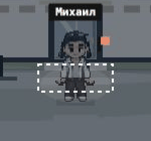

# Бзикер: цельные кадры бега, версия 15

Исправлена сборка анимации по присланному пользователем атласу 4×4. При движении отображаются четыре **цельных** кадра каждого направления в исходном порядке: 1 → 2 → 3 → 4 → 1. Между ними не создаются промежуточные позы.

## Причина и изменение

Раньше игра приклеивала неподвижную голову стоящего персонажа к отдельно подогнанному телу бегущего. В боковых ракурсах тело растягивалось по вертикали сильнее, чем по горизонтали. Теперь используется полный кадр: его голова, руки, корпус и ноги.

У всех 16 кадров один равномерный масштаб. Размер прозрачной рамки 48×64, опора (24,63); запас по бокам сохраняет широкий шаг. При нормализации исключены соседние ячейки исходного изображения. Оба исходных PNG сохранены без изменения.

Существующий ритм движения сохранён: каждый исходный кадр держится 32 единицы пройденного пути. Внутренние восемь отсчётов дают последовательность 1,1,2,2,3,3,4,4. При остановке, телефоне, сидении и действиях бег прекращается. Настройка уменьшения движения сохраняется.

Кастомизация применяется поверх цельного кадра. Волосы и головные аксессуары учитывают положение движущейся головы. Женская фигура немного ниже и уже в талии, с той же опорой ног. Пропорции SVG в меню исправлены на 48:64.

## Проверка

- До исправления новая проверка воспроизвела несовпадение полного кадра и изменение масштаба между кадрами.
- После исправления:404/404 JavaScript-проверки, без пропусков. [Полный лог](run-slideshow-v15-tests.txt).
- Проверяются все16 исходных кадров целиком, порядок показа, общий масштаб, отсутствие обрезки шага и попадания соседнего персонажа в прозрачные поля.
- Независимая проверка:25/25 профильных тестов. Найденное старое CSS-соотношение 5:8 исправлено; в браузере проверены viewBox 48×64 и соотношение 3:4.
- В одной существующей вкладке выполнены реальные проходы вверх, вниз, влево и вправо, движение экранным джойстиком и проверка широкого экрана. Размеры 390×844 и 1280×900. Новые вкладки не открывались. Ошибок и предупреждений в журнале браузера не получено.
- Сохранены проверки действий, телефона в положении сидя, предмета в руке, внешности и других систем. Серверная логика и экономика этой правкой не менялись; серверные проверки прежних версий относятся к прежним версиям.

[Анимационный просмотр исходных поз](run-slideshow-v15.gif) · [Все 40 кадров покоя и бега](run-slideshow-v15.png) · [Кастомизация](run-customization-v15.png) · [Кадры из работающей игры](run-browser-directions-v15.png).

Предыдущая версия14 с неподвижной головой является исторической; её описание и логи сохранены отдельно.
