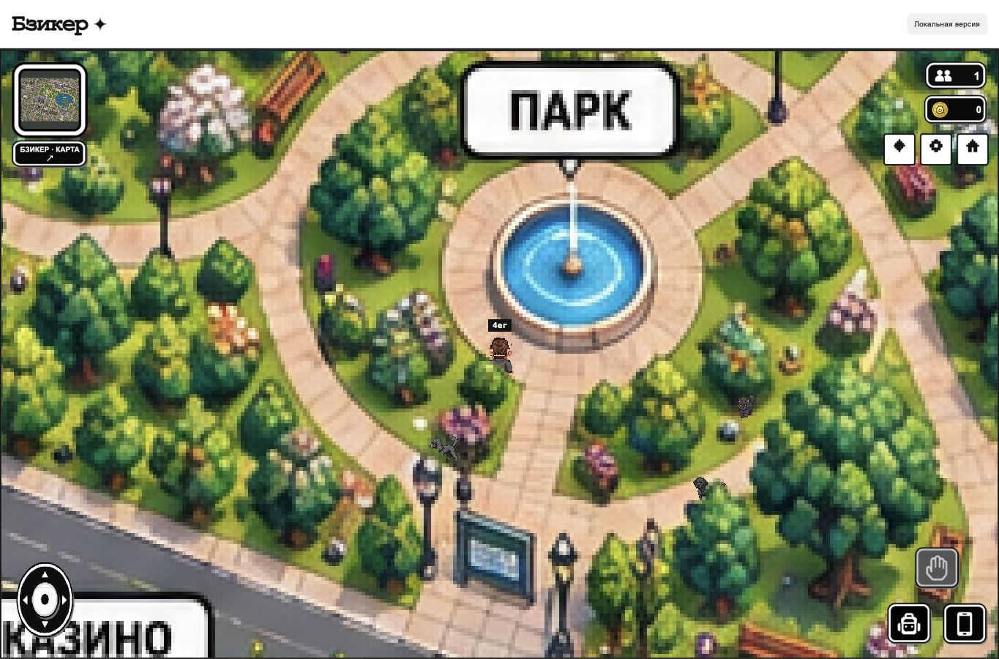
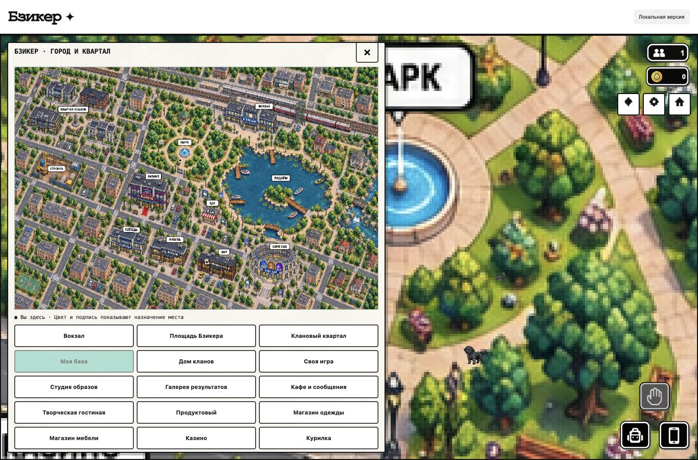
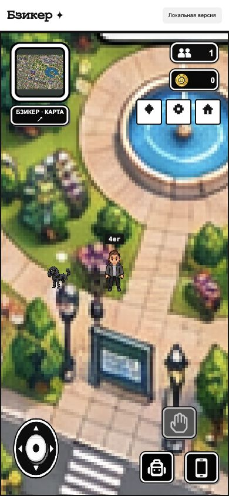
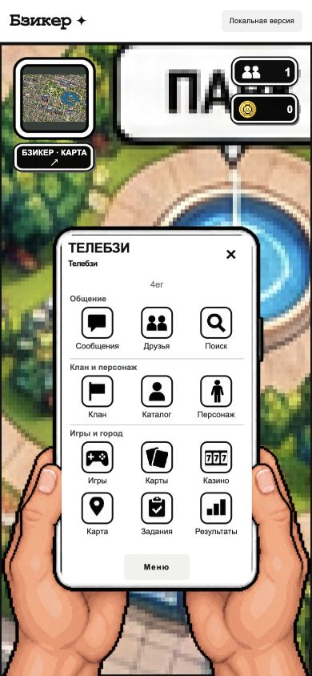

# Бзикер: точные исходные сцены, версия 19

Проверка от 2026-10-11. Использованы материалы `source-reference`. Целый оригинал города и пять целых общественных интерьеров перенесены без перестановки объектов, перекраски или самостоятельной новой композиции.

## Подтверждённый рисунок

- Город 1536×1024: импортированный PNG и фактический Canvas-рендер совпадают с исходником по всем пикселям. В игровом мире применяется единый масштаб 5×; большая карта и мини-карта используют тот же оригинал.
- Пять интерьеров — вокзал, казино, одежда, бар и «Бзик хаб» — скопированы побайтно. Их визуальные пиксели совпадают после одинаковой растеризации в Native Canvas. Прозрачные пиксели нормализуются стандартным alpha premultiplication; невидимый RGB не участвует в визуальном сравнении.
- Маски перекрытия возвращают только пиксели самих предметов из оригинала. Отдельно проверены фонари, автомобили, вывеска, четыре видимых сегмента поезда, три навеса и две опоры моста. Платформенный пол остаётся проходимым.
- Двери, выходы, скамейки, действия, берега, островной мост, точки посадки в лодку и маршруты животных размечены по исходному рисунку. Физическая разметка содержит 887 препятствий.

[Целый город](city-overview.png), [пять интерьеров](interior-overview.png), [проверка города](city-pixel-equality.json), [проверка интерьеров](interior-pixel-equality.json), [сопоставление комнат](exact-interior-scenes.json), [видимость персонажей](actor-visibility.json).

## Результаты проверки

| Проверка | Результат |
| --- | --- |
| Полный JavaScript-набор | 562/562, ошибок 0, пропусков 0 |
| Полный Python-набор | 280/280, ошибок 0 |
| HTTP-ресурсы приложения | 111 маршрутов, 55 разных файлов, расхождений 0 |
| Импортированные рисунки и шрифт по HTTP | 994 файла, расхождений 0 |
| Перенос сохранений 5→19 на временном клоне | 33 таблицы, 159 строк: все поля сохранены |
| Оригинальная резервная копия | открыта только для чтения, SHA256 до/после совпадает |
| Целостность резервной и действующей баз | `ok` |
| Действующая база после проверки игры | 31/37 таблиц полностью совпадают с резервной копией; различия только в разрешённом текущем состоянии сессии/активности/мира |
| Браузер | существующая вкладка, новых вкладок 0; 1365×900 и 390×844 |
| Свежие ошибки браузера | 0 после финальной перезагрузки |

Проверены движение клавиатурой и мобильным джойстиком, карта и переходы, отдельный инвентарь с 10 ячейками, открытие телефона с сохранением координат и телефонной позой. Проверка экрана телефона выполнена через размер браузерного окна; отдельный физический телефон и нагрузка 100 игроков не проверялись.

[JavaScript-лог](javascript-tests.log), [Python-лог](python-tests.log), [HTTP](http-static.json), [рисунки по HTTP](http-all-art.json), [сохранение миграции](migration-preservation.json), [состояние основной базы](progress-preservation.json), [браузер](browser-check.json).

## Границы переноса

В исходной папке находятся пять разных целых общественных интерьеров. Одиннадцать действующих комнат используют именно эти пять композиций. Продукты, мебель и терраса пока повторяют исходный бар; результаты и управление кланами — исходный «Бзик хаб». Это явно отмечено в данных; новые индивидуальные интерьеры поверх исходников не выдуманы.

Фасады в целой карте сохраняют исходный вид. Выбор модели/цвета дома сохраняется в каталоге и профиле клана; индивидуальная перестройка фасада поверх этой карты не выполняется. Частная база сохраняет редактор, 12 плоских отделочных материалов, цвет, расстановку и четыре самостоятельных исходных ракурса мебели.

Статичные люди, машины, лодки и другие детали внутри PNG остаются частью исходной иллюстрации. Движущиеся игроки, животные и занятые лодки имеют отдельное состояние. Наличие изображения в каталоге не объявляется новой игровой механикой. Шесть ранее сгенерированных дополнений сохранены как исторические материалы и отключены в действующей точной сцене.

Аккаунты, парольные данные, кошельки, начисления, предметы, кланы, лобби, приглашения, задания и сообщения сохранены. Только разрешённые текущие позиции/лодки/метаданные мира меняются при миграции. Табличные отчёты не содержат значений персональных полей.

## Воспроизведение

```sh
node --test tests/*.test.mjs
python3 -m unittest discover -s tests -v
python3 scripts/check-migration-preservation.py --expected-map-sha a548c872ebfa973e3830418daf4f3b72a926647963350cb1993838ba2c8ed02b --final-geometry
```

Точный SHA карты: `a548c872ebfa973e3830418daf4f3b72a926647963350cb1993838ba2c8ed02b`. SHA физической разметки: `c4491dfd3163a5f3f916b3977f3e3002e37d982474fdc858db30ad69d4224a3f`. Миграционный помощник проверяет оба файла и прекращает проверку при несовпадении. Основную базу он не открывает: инициализация работает на удаляемом временном клоне.

## Игра и изображения браузера

Игра оставлена запущенной на [http://127.0.0.1:8791](http://127.0.0.1:8791). Адрес действует на этом компьютере; внешнее размещение HTTPS и живой Telegram-бот пока не выполнены.








